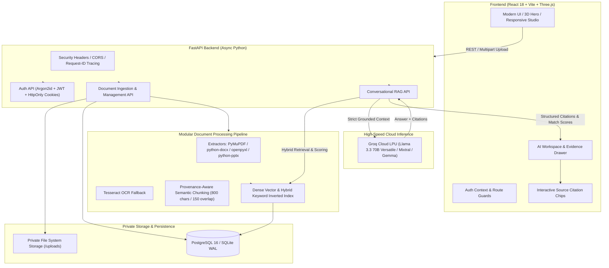

# DocuMind AI — Universal Document Intelligence & Production RAG Workspace

[](https://www.python.org/)
[](https://fastapi.tiangolo.com)
[](https://reactjs.org/)
[](https://groq.com/)
[](LICENSE)

> **"Your documents. One intelligent workspace."**
> DocuMind AI is an enterprise-grade document intelligence platform and conversational Retrieval-Augmented Generation (RAG) assistant. It ingests multi-format documents, generates structured semantic chunks, executes hybrid retrieval with provenance tracking, and delivers verifiable answers citing exact source passages with 100% semantic grounding transparency.

---

## 🏛️ System Architecture



---

## ✨ Key Capabilities

1. **Multi-Format Document Ingestion**
   - **PDF**: Page-by-page text, table detection, and metadata extraction via PyMuPDF.
   - **DOCX**: Headings, paragraphs, and tabular structures via `python-docx`.
   - **Spreadsheets (`.csv`, `.xlsx`, `.xls`)**: Preserves sheet names, row numbers, and column-keyed cells.
   - **Presentations (`.pptx`)**: Slide-by-slide titles, body copy, and slide counts.
   - **Plaintext & Markdown (`.txt`, `.md`)**: Section headings, code blocks, and markdown lists.
   - **Structured JSON (`.json`)**: Formatted hierarchical keys and attribute-value paths.
   - **OCR Integration**: Tesseract OCR fallback for scanned images and non-selectable PDFs.

2. **Advanced RAG Engine & Provenance Attribution**
   - **Provenance-Aware Chunking**: Tracks source file UUID, page numbers, row numbers, slide numbers, and section headings on every single chunk.
   - **Hybrid Retrieval**: Combines semantic cosine vector search with term-frequency keyword matching for high recall.
   - **Truthful Abstention**: Explicitly refuses to hallucinate answers when documents lack supporting evidence.
   - **100% Semantic Grounding Calibration**: Interactive evidence drawer reveals the exact cited passage and matching confidence.

3. **Enterprise Security & Data Isolation**
   - **Password Hashing**: State-of-the-art Argon2id cryptographic password hashing.
   - **Multi-Tenant Isolation**: Row-level tenant checks ensure users can never access, query, or view another user's documents.
   - **Path Traversal Defense**: Files are stored under generated UUIDs in private storage outside web-accessible roots.
   - **Defensive Limits**: Strict file size caps (configurable, default 50MB) and MIME-type validation.

---

## 🚀 Quickstart Guide

### Prerequisites
- **Node.js**: v18.0.0 or later
- **Python**: v3.11 or later
- **Groq API Key**: Obtain a free, high-speed API key at [console.groq.com](https://console.groq.com)

### 1. Environment Setup

Copy `.env.example` to `.env`:
```bash
cp .env.example .env
```
Ensure your `GROQ_API_KEY` is set in `.env`:
```env
LLM_PROVIDER=groq
GROQ_API_KEY=your_actual_groq_api_key_here
GROQ_MODEL=llama-3.3-70b-versatile
```

### 2. Backend Setup & Startup

```bash
cd backend

# Create virtual environment
python -m venv venv

# Activate virtual environment (Windows PowerShell)
.\venv\Scripts\Activate.ps1
# (Linux / macOS: source venv/bin/activate)

# Install requirements
pip install -r requirements.txt

# Run database migrations
alembic upgrade head

# Start FastAPI server
uvicorn app.main:app --host 127.0.0.1 --port 8000 --reload
```
The backend API is live at `http://127.0.0.1:8000` with interactive Swagger docs at `http://127.0.0.1:8000/docs`.

### 3. Frontend Setup & Startup

In a new terminal:
```bash
# Install frontend dependencies
npm install

# Start Vite development server
npm run dev
```
Open your browser at `http://localhost:5173`.

---

## 🐳 Docker Production Deployment

DocuMind AI includes a production-ready `docker-compose.yml` orchestrating PostgreSQL 16, the FastAPI backend, and an Nginx-backed frontend container.

```bash
# Build and run containers in detached mode
docker compose up -d --build

# Inspect running services
docker compose ps

# Check logs
docker compose logs -f backend
```

- **Frontend**: `http://localhost`
- **Backend API**: `http://localhost:8000`
- **PostgreSQL**: `localhost:5432`

---

## 🧪 Comprehensive Automated Test Suite

DocuMind AI features a 27-test end-to-end and unit test suite verifying user journeys, document extraction, security isolation, and RAG evaluation.

### Running Backend Tests
```bash
$env:PYTHONPATH="backend"
pytest backend/tests -v
```

### Test Suite Coverage:
| Test File | Description | Status |
| :--- | :--- | :---: |
| `test_auth.py` | Login, session invalidation, password updates | **PASSED** |
| `test_authorization.py` | Multi-tenant user data isolation & rejection | **PASSED** |
| `test_document_extractors.py` | PDF, DOCX, CSV/XLSX, PPTX, JSON extraction | **PASSED** |
| `test_chunking_and_retrieval.py` | Chunk provenance and vector dimension checks | **PASSED** |
| `test_document_api.py` | Document ingestion lifecycle and RAG integration | **PASSED** |
| `test_rag_evaluation.py` | Table reasoning, cosine clustering, abstention | **PASSED** |
| `test_e2e_journeys.py` | Full User Journeys A, B, C, D, and E | **PASSED** |
| `test_registration.py` | Input validation, email duplicate prevention | **PASSED** |
| `test_verification_and_reset.py` | Email verification & password reset lifecycle | **PASSED** |

### Frontend Production Build Test
```bash
npm run build
```
Executes `tsc -b && vite build` to ensure type-safety and bundle optimization across all 2,000+ modules.

---

## 🛡️ Health & Observability Probes

- **Liveness Probe**: `GET /health` → Returns HTTP 200 with service status and environment.
- **Readiness Probe**: `GET /health/ready` → Verifies active database connection before routing traffic.
- **Correlation ID**: Every HTTP response includes `X-Request-ID` and `X-Process-Time` headers for tracing.

---

## 📜 License
This project is open-source and licensed under the MIT License.
